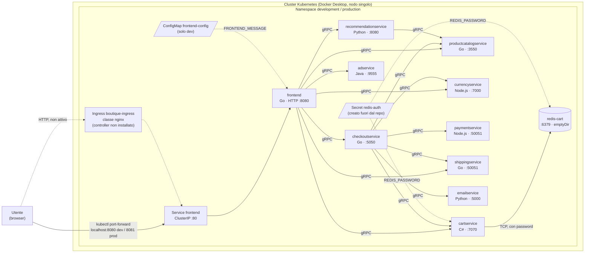
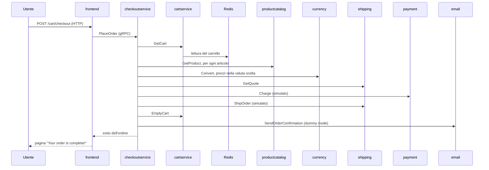
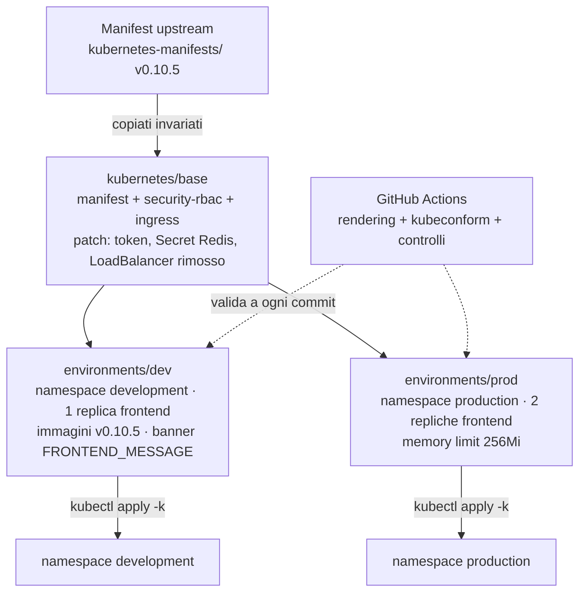

# Architettura

Documento architetturale della soluzione: componenti di Online Boutique, flussi di comunicazione, come è stata rilasciata su Kubernetes e perché. Per i comandi e le evidenze si rimanda al [README](../README.md).

## 1. Contesto

Online Boutique è un e-commerce dimostrativo composto da dieci microservizi più Redis. L'utente usa un sito web servito dal frontend; il frontend e il checkout orchestrano gli altri servizi tramite gRPC. Pagamento, spedizione ed email sono simulati: nessun dato esce dal cluster.

La soluzione rilascia l'applicazione su un cluster Kubernetes locale (Docker Desktop, nodo singolo) in due ambienti isolati per namespace, `development` e `production`, gestiti con Kustomize a partire dagli stessi manifest.

## 2. Componenti

| Servizio | Linguaggio | Protocollo e porta | Ruolo | Chiama |
|---|---|---|---|---|
| `frontend` | Go | HTTP 8080 (Service 80) | Sito web, unico punto d'ingresso per l'utente | productcatalog, currency, cart, recommendation, shipping, checkout, ad |
| `checkoutservice` | Go | gRPC 5050 | Orchestra l'ordine | productcatalog, cart, currency, shipping, payment, email |
| `cartservice` | C# | gRPC 7070 | Gestisce i carrelli | Redis |
| `productcatalogservice` | Go | gRPC 3550 | Catalogo prodotti, letto da un file JSON nell'immagine | — |
| `currencyservice` | Node.js | gRPC 7000 | Conversione di valuta | — |
| `paymentservice` | Node.js | gRPC 50051 | Pagamento simulato | — |
| `shippingservice` | Go | gRPC 50051 | Preventivo e spedizione simulati | — |
| `emailservice` | Python | gRPC 8080 (Service 5000) | Email di conferma simulata (*dummy mode*) | — |
| `recommendationservice` | Python | gRPC 8080 | Prodotti consigliati | productcatalog |
| `adservice` | Java | gRPC 9555 | Annunci contestuali | — |
| `redis-cart` | Redis | TCP 6379 | Archivio dei carrelli, unico componente stateful | — |
| `loadgenerator` | Python (Locust) | — | Traffico simulato. **Non incluso nel deploy** | — |

Ogni servizio ha un Deployment, un Service ClusterIP con lo stesso nome e un ServiceAccount dedicato. I servizi si trovano tramite DNS del cluster, con gli indirizzi passati come variabili d'ambiente (es. `CART_SERVICE_ADDR=cartservice:7070`).

## 3. Diagramma dei componenti e dei flussi

Le linee tratteggiate indicano configurazione (Secret, ConfigMap) o percorsi non attivi (Ingress senza controller).

## 4. Flusso di un ordine

Sequenza semplificata del checkout, il flusso che attraversa più servizi ed è usato come test end-to-end:

Un guasto di uno qualsiasi di questi servizi fa fallire l'ordine: il checkout è il punto in cui le dipendenze si concentrano. Il log di `emailservice` è la prova che l'ordine ha attraversato tutta la catena (README, sezione 4.6).

## 5. Corrispondenza con i ruoli richiesti dalla traccia

| Ruolo | Nella soluzione |
|---|---|
| Client / API consumer | Browser e `Invoke-WebRequest`. L'applicazione non espone un'API REST pubblica: il frontend serve pagine HTML |
| Ingress / Route | Ingress `boutique-ingress` (classe nginx), non attivo per assenza del controller; accesso di test tramite `kubectl port-forward` sul Service `frontend` |
| API service | `frontend`, unico servizio esposto verso l'utente |
| Worker / componente asincrono | **Assente.** Tutte le chiamate sono sincrone; `emailservice` è l'operazione più vicina a un'elaborazione secondaria, ma viene chiamata in modo sincrono dal checkout. Il `loadgenerator`, unico componente "in background", non è incluso nel deploy |
| Database / cache / broker | Redis (`redis-cart`) per i carrelli; nessun message broker |
| ConfigMap e Secret | ConfigMap `frontend-config` generata per ambiente (solo dev), Secret `redis-auth` creato fuori dal repository |
| CI/CD | GitHub Actions: validazione dei manifest a ogni commit; deploy manuale con `kubectl apply -k` |
| Monitoring e logging | Probe di liveness e readiness, log JSON strutturati, metrics-server, metrica di latenza ricavata dai log |
| Krateo | Valutato in `docs/krateo.md` |

## 6. Deployment con Kustomize

- **Base:** i manifest upstream restano invariati; le modifiche passano da patch nella `kustomization.yaml`, così si vede chiaramente cosa è stato cambiato rispetto all'originale.
- **Overlay:** contengono solo le differenze tra ambienti: namespace, registry e tag delle immagini, repliche, limiti, ConfigMap.
- **Isolamento:** per namespace, non per prefisso dei nomi (README, sezione 7, caso 3). Ogni namespace ha il proprio Secret con una password diversa.

## 7. Configurazione e sicurezza

| Aspetto | Scelta |
|---|---|
| Indirizzi dei servizi | Variabili d'ambiente nei manifest, risolte dal DNS del cluster |
| Configurazione per ambiente | `configMapGenerator` negli overlay: l'hash nel nome rende ogni modifica un rollout tracciato |
| Credenziali | Secret `redis-auth` creato con `kubectl` da un file fuori dal repository; usato da Redis (`--requirepass`) e da cartservice |
| Identità dei pod | ServiceAccount dedicato per ogni servizio, token non montato (`automountServiceAccountToken: false`) |
| Permessi | Nessun permesso RBAC all'applicazione; ruolo di sola lettura `boutique-ops-viewer` per il supporto L2 |
| Container | Non root, capabilities rimosse, filesystem in sola lettura, requests e limits definiti (dai manifest upstream) |
| Esposizione | Solo tramite il Service `frontend`; il Service LoadBalancer upstream è rimosso |

Dettagli e verifiche nella sezione 8 del README.

## 8. Osservabilità

| Livello | Strumento | Cosa mostra |
|---|---|---|
| Salute dei pod | Probe di liveness e readiness (HTTP `/_healthz` per il frontend, gRPC per gli altri) | Se il processo risponde; la readiness decide se il pod riceve traffico |
| Eventi | `kubectl get events`, `kubectl describe` | Pull delle immagini, configurazione mancante, rollout |
| Log | Log JSON strutturati del frontend e degli altri servizi | Richieste, stato HTTP, latenza (`http.resp.took_ms`) |
| Risorse | metrics-server, `kubectl top` | CPU e memoria di nodo e pod, da confrontare con requests e limits |
| Metrica applicativa | Script `frontend-metrics.ps1` sui log | Richieste per stato, latenza mediana e 95° percentile |

Evoluzione prevista: Prometheus e Grafana **[DA COMPLETARE]**.

## 9. Scelte e trade-off

| Scelta | Alternativa | Motivazione |
|---|---|---|
| Kustomize | Helm | I manifest upstream sono YAML semplici: Kustomize li modifica con patch senza riscriverli come template, ed è integrato in `kubectl`. Helm sarebbe più adatto per distribuire l'applicazione come pacchetto parametrizzato a team esterni |
| Isolamento per namespace | `namePrefix` | `namePrefix` rompeva gli indirizzi nelle variabili d'ambiente (caso 3); il namespace isola gli ambienti mantenendo i nomi originali |
| Immagini ufficiali nel cluster | Immagini costruite in proprio | Riproducibilità e tempi: la build del frontend è dimostrata in locale (sezione 4.7), ma il nodo del cluster non vede le immagini locali e serve un registry |
| Secret creato a mano | External Secrets, Sealed Secrets | Nessuna dipendenza aggiuntiva in locale; il limite è dichiarato e l'evoluzione indicata |
| Redis con `emptyDir` | PersistentVolumeClaim, servizio gestito | Configurazione upstream mantenuta: i carrelli sono dati di sessione e la perdita è accettabile in un ambiente dimostrativo |
| Port-forward | Ingress attivo | Il cluster non ha un ingress controller **[DA COMPLETARE: ingress-nginx]** |
| CI di sola validazione | Deploy automatico (CD o GitOps) | Il cluster è locale e non raggiungibile da GitHub; la validazione intercetta gli errori prima dell'apply |

## 10. Punti di estensione

- **Ingresso:** ingress controller (nginx) e TLS.
- **Rete:** NetworkPolicy per limitare chi può raggiungere Redis; service mesh per mTLS tra i servizi.
- **Segreti:** External Secrets Operator con un vault, per esempio Azure Key Vault.
- **Dati:** Redis persistente o gestito.
- **Rilascio:** GitOps con Argo CD o Flux, con prune delle risorse rimosse.
- **Osservabilità:** Prometheus, Grafana e tracciamento con OpenTelemetry (il frontend ha già il tracing, disattivato).
- **Piattaforma:** esposizione come servizio self-service con Krateo (`docs/krateo.md`).