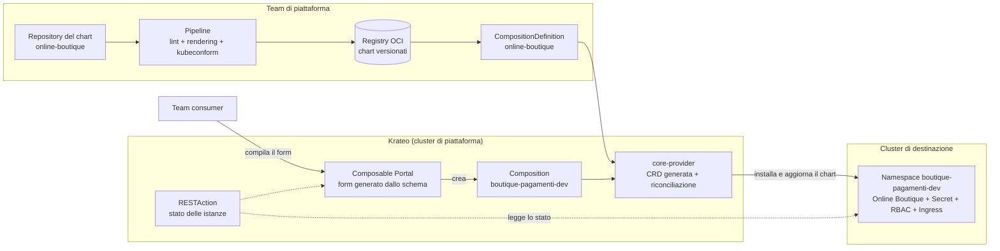

# Valutazione di Krateo PlatformOps

Valutazione di Krateo come layer di Platform Engineering per offrire Online Boutique ai team interni come servizio self-service. Il documento è un **blueprint con YAML concettuale**: non è stata realizzata una PoC (vedi sezione 8).

> Riferimenti: repository ufficiali `krateo-platformops` su GitHub e documentazione su docs.krateo.io (consultati a ottobre 2026). I dettagli delle API vanno verificati sulla versione effettivamente adottata.

## 1. Krateo in breve

Krateo PlatformOps è un framework open source per costruire una piattaforma interna su Kubernetes. I concetti usati in questa valutazione:

| Concetto | Cos'è |
|---|---|
| **Composition (chart)** | Un chart Helm con un file `values.schema.json`, che descrive i parametri accettati |
| **CompositionDefinition** | Risorsa che registra un chart in Krateo; il **core-provider** ne legge lo schema e genera una nuova CRD |
| **Composition (istanza)** | Risorsa della CRD generata, compilata dal team consumer; il core-provider la riconcilia installando e aggiornando il chart |
| **Composable Portal** | Portale web (frontend + snowplow) costruito con widget dichiarati come risorse Kubernetes: form, tabelle, pannelli |
| **RESTAction** | Risorsa che descrive chiamate ad API (Kubernetes o esterne) i cui risultati alimentano i widget del portale |
| **Blueprint / marketplace** | Composition pronte, distribuite come chart, che uniscono risorse e pagine del portale |

Il modello è quello del platform engineering: il team di piattaforma prepara un template, i team consumer lo usano da un form senza conoscere i dettagli di Kubernetes.

## 2. Il problema che risolverebbe

Oggi, per avere un'istanza di Online Boutique, un team deve:

1. creare il namespace;
2. generare la password di Redis e creare il Secret `redis-auth` (senza Secret, Redis e cartservice non partono: README, sezione 8.2);
3. conoscere la struttura degli overlay Kustomize e applicarli con `kubectl apply -k`;
4. rimuovere a mano le risorse non più presenti nei manifest (README, sezione 8.7);
5. sapere quali valori sono ragionevoli per repliche, limiti e versioni.

Sono tutti passi documentati, ma manuali e soggetti a errore: il troubleshooting della sezione 7 del README nasce in buona parte da questi passaggi. Il golden path li sostituisce con un form e un'unica risorsa dichiarativa.

## 3. Il golden path proposto

**"Ambiente Online Boutique"**: un team chiede un'istanza dell'applicazione con pochi parametri e riceve un ambiente già conforme agli standard definiti in questo progetto.

Cosa diventa template, cioè resta fisso e non è configurabile dal consumer:

| Elemento | Origine nel progetto |
|---|---|
| Manifest dei dieci servizi e di Redis | `kubernetes/base` |
| Patch di sicurezza: token dei ServiceAccount disattivato, ServiceAccount di Redis, Service LoadBalancer rimosso | README, sezione 8 |
| Password di Redis generata per istanza, mai esposta al consumer | README, sezione 8.2 |
| Ruolo di sola lettura per il supporto L2, collegato al gruppo del team | README, sezione 8.4 |
| Immagini da registry fissato, con tag consentiti | README, sezione 7, casi 1 e 2 |
| Ingress e, se adottata, sonda di monitoraggio | README, sezione 4.5 e sezione 10.4 |

Cosa resta parametro, cioè lo sceglie il consumer: vedi sezione 4.

## 4. Parametri esposti al team consumer

| Parametro | Tipo | Esempio | Vincolo nello schema | Perché |
|---|---|---|---|---|
| `serviceName` | stringa | `boutique-pagamenti` | minuscole, numeri e trattini, max 40 caratteri | Nome dell'istanza e prefisso del namespace |
| `environment` | elenco | `dev` | `dev`, `prod` | Determina i valori predefiniti di repliche e limiti, come gli overlay attuali |
| `namespace` | stringa | `boutique-pagamenti-dev` | derivato da `serviceName` e `environment` se non indicato | Isolamento per namespace (README, sezione 7, caso 3) |
| `size` | elenco | `small` | `small`, `medium`, `large` | Profili di risorse predefiniti invece di requests e limits liberi |
| `frontendReplicas` | intero | `2` | da 1 a 5; predefinito 1 in dev, 2 in prod | Disponibilità del frontend |
| `imageTag` | elenco | `v0.10.5` | solo tag verificati nel registry | Evita tag inesistenti (README, sezione 6.3 e caso 2) |
| `ingress.host` | stringa | `pagamenti.boutique.local` | formato hostname; facoltativo | Esposizione tramite Ingress |
| `repository` | URL | `https://github.com/org/boutique-pagamenti` | facoltativo | Collegamento al repository del team |
| `owner` | stringa | `team-pagamenti` | obbligatorio | Responsabile dell'istanza; usato per RBAC ed etichette |
| `tier` | elenco | `bronze` | `bronze`, `silver`, `gold` | Livello di servizio: determina, per esempio, repliche minime e monitoraggio |
| `bannerMessage` | stringa | `Ambiente DEV` | facoltativo, max 80 caratteri | La stessa configurazione per ambiente di `FRONTEND_MESSAGE` (README, sezione 8.5) |

Il form del portale nasce dallo schema: i vincoli (`enum`, `pattern`, minimi e massimi) impediscono valori non validi prima ancora che arrivino al cluster, come fa oggi la pipeline (README, sezione 9) ma più a monte. Estratto concettuale del `values.schema.json`:

```json
{
  "$schema": "https://json-schema.org/draft/2020-12/schema",
  "type": "object",
  "required": ["serviceName", "environment", "owner"],
  "properties": {
    "serviceName": { "type": "string", "pattern": "^[a-z0-9-]{3,40}$" },
    "environment": { "type": "string", "enum": ["dev", "prod"], "default": "dev" },
    "size": { "type": "string", "enum": ["small", "medium", "large"], "default": "small" },
    "frontendReplicas": { "type": "integer", "minimum": 1, "maximum": 5, "default": 1 },
    "imageTag": { "type": "string", "enum": ["v0.10.4", "v0.10.5"], "default": "v0.10.5" },
    "owner": { "type": "string" },
    "tier": { "type": "string", "enum": ["bronze", "silver", "gold"], "default": "bronze" }
  }
}
```

## 5. Prerequisito: da Kustomize a chart Helm

Krateo compone **chart Helm**, mentre questo progetto usa **Kustomize**. Per adottarlo va creato un chart `online-boutique` che:
- contenga i manifest della base come template, con i parametri della sezione 4 al posto dei valori fissi degli overlay;
- includa le patch di sicurezza già applicate (sezione 8 del README), così ogni istanza nasce conforme;
- generi la password di Redis all'interno del chart o la ottenga da un gestore di segreti (es. External Secrets con Azure Key Vault), senza esporla nel form;
- abbia il proprio `values.schema.json`.

Il repository originale di Online Boutique include anche un chart Helm: può essere un punto di partenza, ma le modifiche di sicurezza di questo progetto andrebbero riportate al suo interno. La pipeline andrebbe estesa per validare il chart (`helm lint`, rendering con valori di esempio, kubeconform) e pubblicarlo in un registry OCI.

## 6. YAML concettuale

Registrazione del chart in Krateo, eseguita una volta dal team di piattaforma:

```yaml
apiVersion: core.krateo.io/v1alpha1
kind: CompositionDefinition
metadata:
  name: online-boutique
  namespace: krateo-system
spec:
  chart:
    url: oci://ghcr.io/<organizzazione>/charts/online-boutique
    version: "0.1.0"
```

Il core-provider genera una CRD a partire dallo schema del chart. Una richiesta del team consumer, che il portale crea compilando il form, sarebbe del tipo:

```yaml
# Gruppo, versione e kind sono generati dal core-provider a partire dal chart:
# i valori qui sotto sono indicativi.
apiVersion: composition.krateo.io/v0-1-0
kind: OnlineBoutique
metadata:
  name: boutique-pagamenti-dev
  namespace: krateo-system
spec:
  serviceName: boutique-pagamenti
  environment: dev
  size: small
  frontendReplicas: 1
  imageTag: v0.10.5
  owner: team-pagamenti
  tier: bronze
  bannerMessage: "Ambiente DEV - team pagamenti"
```

Il core-provider installa il chart con questi valori e lo mantiene allineato: una modifica della risorsa (per esempio `imageTag`) produce un aggiornamento, la cancellazione rimuove l'istanza.

### 6.1 Oltre i componenti Kubernetes

Un chart registrato in Krateo può contenere qualsiasi risorsa Kubernetes, comprese le risorse personalizzate di altri operatori. Questo permette alla stessa composition di orchestrare anche componenti esterni al cluster. Proposta concettuale per Online Boutique, da verificare sulla versione di Krateo adottata:

| Componente | Oggi | Con Krateo |
|---|---|---|
| Componenti Kubernetes (Deployment, Service, Ingress, RBAC) | Manifest gestiti con Kustomize | Template del chart, installati e riconciliati dal core-provider |
| Database / cache (Redis) | Redis nel cluster con `emptyDir` | Un parametro sceglie tra Redis nel cluster (dev) e un servizio gestito (prod, es. Azure Cache for Redis), creato tramite l'operatore del cloud provider referenziato dal chart; la stringa di connessione arriva come Secret, senza passare dal form |
| Repository e pipeline | Repository e workflow creati a mano | Un blueprint di scaffolding crea il repository del team da un template, già con la pipeline di validazione, tramite un provider GitHub di Krateo (generato da specifica OpenAPI) |
| Rilascio continuo | `kubectl apply` manuale | La composition crea anche l'applicazione Argo CD che sincronizza il repository del team |
| Servizi esterni | — | RESTAction che interrogano API esterne (stato della pipeline, ticketing, costi) e ne mostrano i dati nel portale accanto all'istanza |

Parametri aggiuntivi nello schema:

```json
{
  "redis": {
    "type": "object",
    "properties": {
      "mode": { "type": "string", "enum": ["inCluster", "managed"], "default": "inCluster" }
    }
  },
  "gitops": {
    "type": "object",
    "properties": {
      "enabled": { "type": "boolean", "default": false }
    }
  }
}
```

Rischi specifici: per creare risorse cloud o repository, la piattaforma deve avere credenziali verso il cloud provider e verso GitHub, quindi diventa un punto sensibile da proteggere (permessi minimi, segreti gestiti con un vault, audit). Ogni operatore o provider aggiunto è un componente in più da aggiornare e monitorare, e un errore nel template ora può creare o modificare risorse a pagamento, non solo oggetti nel cluster.

## 7. Diagramma di integrazione



## 8. Blueprint, PoC e adozione reale

| Livello | Cosa include | Stato in questo progetto |
|---|---|---|
| **Blueprint** | Golden path, parametri, schema, YAML concettuale, diagramma | **Fatto** (questo documento) |
| **PoC minima** | Krateo installato sul cluster locale, chart `online-boutique` registrato con una CompositionDefinition, un'istanza creata dal portale e verificata | **Non realizzata.** Fattibile sul cluster di test (Kubernetes 1.36.1, compatibile con l'installer attuale), ma richiede prima la conversione in chart Helm (sezione 5) |
| **Adozione reale** | Chart mantenuto e versionato, gestione dei segreti, RBAC collegato all'identity provider, cluster di destinazione separati, monitoraggio, supporto ai team | Da valutare (sezione 10) |

## 9. Benefici, prerequisiti, limiti e rischi

| | |
|---|---|
| **Benefici** | Self-service: un ambiente in pochi minuti senza competenze Kubernetes. Standard di sicurezza applicati per costruzione, non lasciati alla documentazione. Validazione dei parametri prima del deploy. Un'unica risorsa per istanza, con ciclo di vita completo (creazione, aggiornamento, cancellazione). Catalogo e stato delle istanze visibili nel portale |
| **Prerequisiti** | Chart Helm con schema (sezione 5). Registry OCI e pipeline per il chart. Gestione dei segreti. Identità dei team (es. gruppi Entra ID) per RBAC. Un cluster su cui far girare Krateo e competenze per gestirlo |
| **Limiti** | Il valore cresce con il numero di team e di template: per un'unica applicazione e un unico team il costo supera il beneficio. Il form espone solo ciò che è nello schema: casi particolari richiedono una nuova versione del chart |
| **Rischi** | Un componente in più da gestire, aggiornare e monitorare (la piattaforma stessa diventa un servizio critico). Progetto in evoluzione rapida: le API sono in versione `v1alpha1` e componenti come il Composition Dynamic Controller sono stati riorganizzati nel tempo, quindi servono aggiornamenti pianificati. Un errore nel template si propaga a tutte le istanze: il chart richiede test e versionamento rigorosi. Rischio di template troppo rigidi, che i team aggirano |

## 10. Raccomandazione

**Non adottarlo subito per questa sola applicazione, ma prepararne le condizioni e verificarlo con una PoC.**

1. **Ora:** convertire la soluzione in chart Helm con `values.schema.json` (sezione 5). È utile anche senza Krateo: rende la soluzione installabile con parametri.
2. **PoC (1-2 giorni):** installare Krateo sul cluster di test, registrare il chart, creare un'istanza dal portale e verificare che nasca conforme (Secret, token disattivati, RBAC), che un aggiornamento di `imageTag` produca un rollout e che la cancellazione rimuova tutto.
3. **Pilota:** con due o tre team reali e almeno due template, misurando tempo di creazione degli ambienti, richieste di supporto e incidenti dovuti a configurazioni manuali.
4. **Adozione:** solo se il pilota mostra un beneficio misurabile, con cluster di piattaforma dedicato, segreti gestiti e RBAC integrato con l'identity provider.

Il momento giusto per adottarlo è quando lo stesso tipo di ambiente viene richiesto da più team e la configurazione manuale diventa una fonte ricorrente di errori: il punto in cui il golden path ripaga il costo della piattaforma.